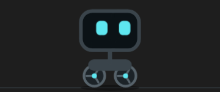
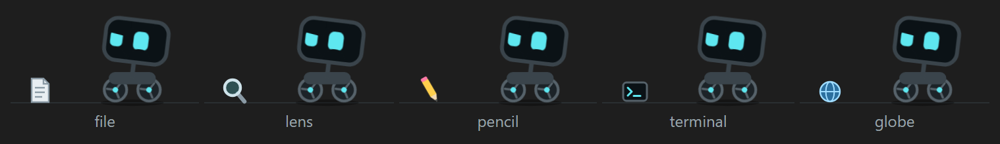
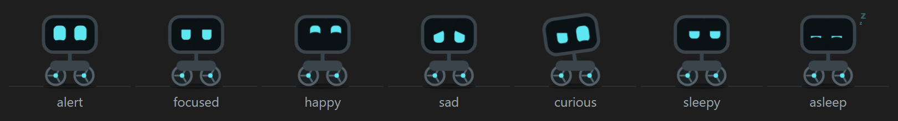
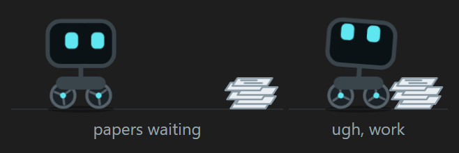
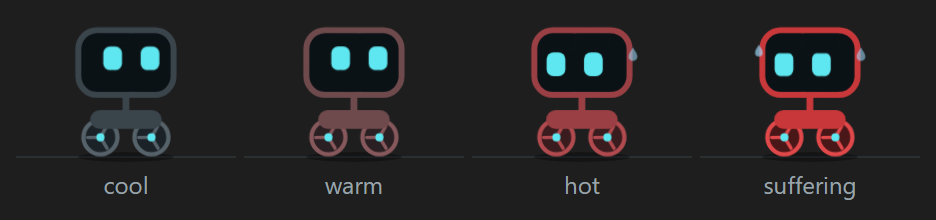
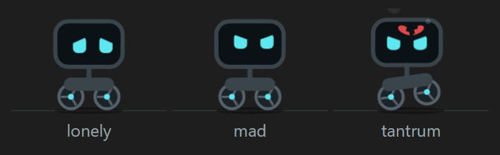
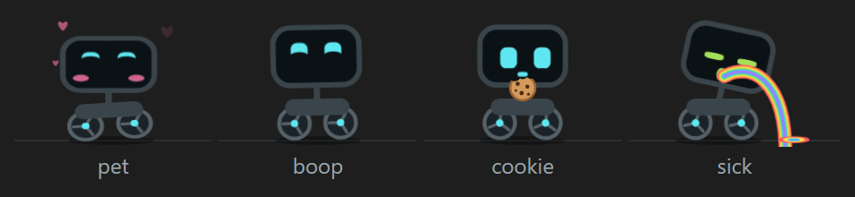
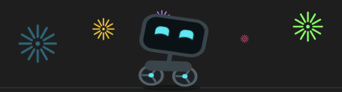
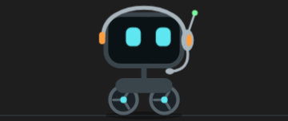

# Muki

**An unofficial robot pet for Claude Code.** Muki lives in a little band above the chat box in the Claude desktop app. He rolls around, watches what Claude is doing, and reacts to it with his two big eyes. He's there for company and a laugh, not to help with your work.

Not made by or affiliated with Anthropic.



<!-- Screenshots of Muki in the app. Add docs/images/in-app-1.png and in-app-2.png, then remove the comment marks around each line:


-->

## Where he works

**Claude Code in the desktop app only** (the Code tab). He doesn't appear in the terminal, which can only show still pictures, and everything about him is animation. VS Code isn't supported either.

## What he does

### He watches Claude work

When Claude reads, searches, edits, runs a command or goes on the web, Muki rolls over to a little prop for it: a file, a magnifying glass, a pencil, a terminal or a globe.



His face follows along. He's alert when you send a message, focused while Claude works, happy when an answer arrives and sad when something fails. When a tool needs your OK, he looks curious and waits with you.



### Background tasks pile up

Each task running in the background drops a paper on a pile at the end of his road (up to six). Now and then he rolls over, looks at it and rolls his eyes.



### He moves like a pet

He wanders along the band, and his head lags behind on a spring when he speeds up or stops. Sometimes he watches your mouse. After a quiet spell he gets sleepy, and later he falls asleep.


### He feels the context window

As the chat's context fills up, Muki heats up: warm from 20%, red and sweating from 30%, and suffering from 40%. From 30% he's tired: he rolls slowly and has no energy left to get mad. A suffering Muki means it's time for a new chat.



### He wants attention

Leave him alone too long and he gets lonely (after 10 minutes), then mad (20), then throws tantrums (25): he stamps his wheels, steam puffs off his head, and a red heart breaks and gets stomped flat. A pet or a cookie makes it all better. He never gets mad while he's asleep, and when he's tired (30% context and up) he only gets lonely.



### Play with him

- **Pet him:** hold the mouse button down on him. He leans into your hand, blushes, and hearts float up.
- **Boop him:** click him. Boop him five times in a row and he gets annoyed (unless he's tired).
- **Cookies:** click the band beside him. He dashes over and eats the cookie.
- **Too many cookies:** feed him six in a row and he gets sick. Very sick. With a rainbow.



### He celebrates with you

Tell Claude it worked ("it works", "perfect", "looks good" and so on, as a short message) and Muki jumps for joy with fireworks.



### He puts on a headset

When you message the session from your phone or the web (Remote Control), he puts on a headset. It comes off when you're back at your desk, or after 15 quiet minutes.



## What he doesn't do

He doesn't talk. He makes no model calls and no network calls, so he uses none of your credits. Everything he does comes from Claude Code's own events and your mouse.

## Install

You need the Claude desktop app with a recent Claude Code (mods work there from Claude Code 2.1.286).

In a terminal, run:

```
claude plugin marketplace add MadPonyInteractive/muki-pet
claude plugin install muki-pet@muki-pet
```

Then open a new chat in the Code tab of the desktop app. The terminal and the desktop app share installed plugins, so you only do this once.

To remove him:

```
claude plugin uninstall muki-pet@muki-pet
```

A mod is code that runs on your computer with your permissions. Muki's is small and has no dependencies; you can read all of it in [`muki-pet/`](muki-pet/).

## Develop

You need Node 22.18 or newer (it runs the `.ts` files directly) and Claude Code (the `claude` CLI).

1. `npm install` (dev tools only: the mod itself has no dependencies).
2. Get the mod's TypeScript types: run `claude --plugin-dir ./muki-pet` once from the repo root, then quit it (`/exit`). Claude Code writes the types for your version into `muki-pet/.claude-plugin/types/` when it loads the mod. They aren't committed, and they change with each Claude Code release, so do this again after an update.
3. `npm test` runs the four checks: type-check, golden drawings, `claude plugin test` and `claude plugin validate`, plus a check that the version matches the changelog. If the `claude` on your PATH is older than the app's, point `CLAUDE` at the newer binary.

To see your changes in the desktop app, load the mod from your clone: set `CLAUDE_CODE_PLUGIN_DIRS` to the full path of `muki-pet/` (in `env` in `~/.claude/settings.json`), open a new chat, and type `/reload-plugins` after each edit.

Other tools:

- `node tools/preview.mjs <folder>` previews the robot in a browser, without the app.
- `npm run shots` redraws the pictures in this README (needs Chrome).
- `npm run icon` redraws the plugin icon from his face (needs Chrome).

**Releasing a change:** raise `version` in [`muki-pet/.claude-plugin/plugin.json`](muki-pet/.claude-plugin/plugin.json) and add an entry at the top of [`CHANGELOG.md`](CHANGELOG.md), in the same commit. People who installed Muki keep their copy until that number changes. Then tag the commit `v<version>` and make a GitHub release from the changelog entry.

How it all fits together: [`docs/architecture/how-it-works.md`](docs/architecture/how-it-works.md). How to add a mood, a prop or a new behaviour: [`docs/architecture/how-to-add.md`](docs/architecture/how-to-add.md).

## Licence

MIT, see [`LICENSE`](LICENSE).
